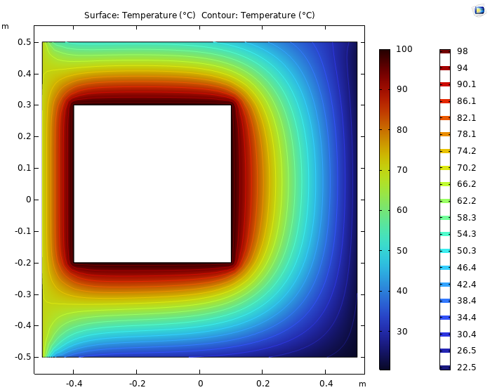

# Square Chimney Heat Transfer Analysis

A heat transfer coursework project by **Pouya Asghari**, using **MATLAB finite-difference modeling** and **COMSOL Multiphysics** to study steady two-dimensional conduction and the effect of cavity placement in a refractory-brick chimney.



## Objective

Calculate temperature distributions for sixteen grid-aligned positions of a square internal cavity and compare selected MATLAB results with COMSOL models. The original report also explores a placement intended to maximize heat-transfer magnitude; the historical heat-rate calculation has a unit inconsistency that must be resolved before accepting that optimum.

## Geometry and boundary conditions

| Quantity | Source setting |
| --- | --- |
| Outer cross section | 1 m × 1 m |
| Cavity cross section | 0.5 m × 0.5 m |
| Minimum grid clearance | 0.1 m |
| MATLAB grid spacing | 0.1 m |
| Out-of-plane depth | 1 m |
| Thermal conductivity | 1 W/(m K) |
| Cavity-wall temperature | 100 °C |
| Left-wall temperature | 70 °C |
| Bottom convection | h = 20 W/(m² K), ambient 20 °C |
| Top convection | h = 10 W/(m² K), ambient 30 °C |
| Right convection | h = 40 W/(m² K), ambient 20 °C |

The grid has 121 positions, including prescribed boundaries and cavity placeholders. There are 74 physical unknown brick-node temperatures for the illustrated configuration. The MATLAB code retains a full matrix system and assigns the prescribed cavity block values.

## Methods and source results

- Finite-difference/control-volume balances for interior, convective-wall, and corner nodes.
- MATLAB linear solves and a sixteen-position cavity search.
- COMSOL temperature contours, isotherms, and selected point comparisons.
- Historical heat-rate comparisons and a source-selected State 5.

**The reported heat rates near 18 kW are not presented as validated physical results.** The MATLAB post-processing mixes Celsius surface temperatures with kelvin ambient temperatures. It also sums convection on three sides while excluding conductive exchange through the fixed-temperature left wall. The variable `maxq` is assigned `min(Qall)`, selecting a signed negative indicator.

The English report preserves the historical values and separately explains these issues, the COMSOL State 1 value discrepancy, and the limits of the coarse placement search. Temperature agreement at a few points does not validate the heat-rate objective.

## Files

| Path | Contents |
| --- | --- |
| [report/main.pdf](report/main.pdf) | English translation with equations, source results, full point-data appendix, and editorial review |
| [report/main.tex](report/main.tex) | Editable LaTeX source |
| `report/figures/` | Original report images plus labeled reconstructed placement illustrations |
| [report/BUILD.md](report/BUILD.md) | Compilation instructions |
| [matlab/state1.mlx](matlab/state1.mlx) | Original State 1 Live Script |
| [matlab/allstates.mlx](matlab/allstates.mlx) | Original sixteen-position Live Script |
| [matlab/state1.m](matlab/state1.m), [matlab/allstates.m](matlab/allstates.m) | Readable code extracted from the Live Scripts |
| `comsol/` | Eleven original MPH models and State 1 point-data exports |
| [docs/RUNNING.md](docs/RUNNING.md) | Software workflow and technical checks |

The COMSOL files include selected numbered states and `Original(DONT TOUCH).mph`. The archive does not contain a native model for every one of the sixteen positions. Preserve the original filenames to maintain the source mapping.

## Requirements and execution

MATLAB is required for the original Live Scripts; the supplied numerical code uses basic matrix and array operations. No specialized toolbox dependency is apparent in the extracted code. The original MATLAB release was not specified.

In MATLAB, set the Current Folder to `matlab/`, then open `state1.mlx` or `allstates.mlx`. The extracted alternatives are `state1.m` and `allstates.m`. Review the heat-rate issues before interpreting the output; these files have not been executed or corrected during repository preparation.

Use a compatible COMSOL installation with the heat-transfer functionality required by the saved MPH models. Open working copies, verify geometry, boundary conditions, mesh, units, depth, and evaluation selections, then solve if appropriate. Native COMSOL models were not opened or recomputed during conversion. See [the running guide](docs/RUNNING.md).

## Build the English report

Upload the complete package ZIP to Overleaf, select `report/main.tex`, and use **pdfLaTeX**. The report imports `matlab/allstates.m`, so retain that sibling path.

Locally, run from the repository root:

```bash
cd report
pdflatex -interaction=nonstopmode -halt-on-error main.tex
pdflatex -interaction=nonstopmode -halt-on-error main.tex
```

Standard LaTeX packages and Latin Modern fonts are sufficient. No custom font or bibliography file is required.

## Academic context and provenance

The report cover identifies Heat Transfer I, School of Mechanical Engineering, College of Engineering, University of Tehran, second semester of academic year 1403–1404 (Iranian calendar). The original source filename contains “HeatII”; this edition follows the cover's course label.

English translation, LaTeX conversion, documentation, and editorial notes were prepared with AI assistance. Native MATLAB and COMSOL files are unchanged. Two geometry illustrations are reconstructed from the permitted grid because the original Word figures use drawing overlays on grid images. They are labeled as reconstructed, not passed off as original screenshots or simulation results.

No corrected heat-rate results, verified optimum, mesh-convergence study, native simulation rerun, or physical validation is claimed.

## License

No license has been selected. Add one after deciding the intended reuse permissions. Referenced software and third-party materials retain their own terms.
